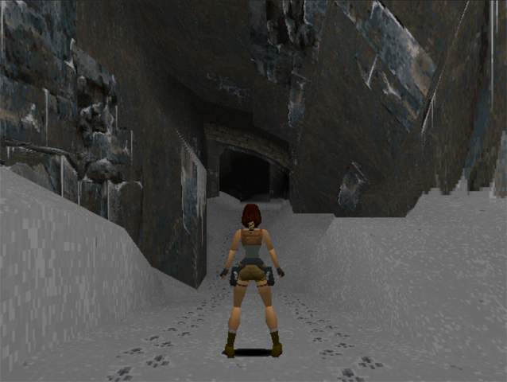

# OpenLara Dreamcast
<p align="center"></p>

This is a port of [OpenLara](https://github.com/XProger/OpenLara) for the Sega Dreamcast.

## Setup instruction
require data
- PC version assets of tomb raider 1. [Tomb Raider 1+2+3](https://www.gog.com/game/tomb_raider_123)

- C:/Steam/steamapps/common/Tomb Raider or C:/GOG Games/Tomb Raider
- how to extract from images mount dosbox.exe
```
mount C .
imgmount d ".\game.dat" -t iso -fs iso
xcopy D:\DATA\ C:\DATA\
```
- Optional: DELDATA included in plastaion 1 of Tomb Raider for level or tittle screen
- example
```
  DATA/*.PHD
  DELDATA/*.RAW
  AUDIO/1/*.WAV

Soundtrack files: 
TRACK_02.WAV, 
TRACK_05.WAV, 
TRACK_22.WAV, 
TRACK_23.WAV, 
TRACK_24.WAV, 
TRACK_25.WAV, 
TRACK_57.WAV, 
TRACK_58.WAV, 
TRACK_59.WAV, 
TRACK_60.WAV

   
```   
   
## Burning
- cdi image at release page not include game data.
- cdi
    - you can burn with [Image Burn](https://www.imgburn.com/index.php?act=download)

## Known Issues
- a lot of

## Build Instructions
you'll need sdk [KallistiOS](http://gamedev.allusion.net/softprj/kos/)
After all setting up compiler and libs
```
  cd src/platform/dc
  make
```


## Credits
- XProger
- Histat
